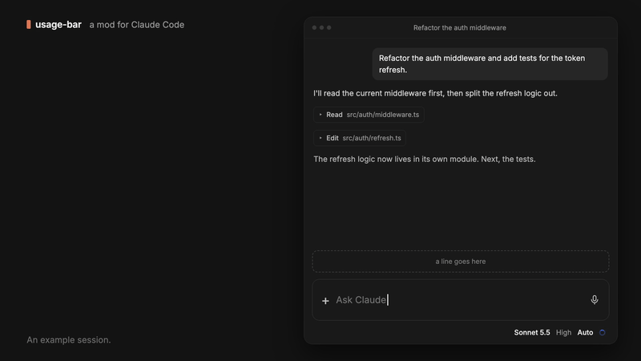

# usage-bar



[Watch with narration](assets/videos/usage-bar-pitch-landscape.mp4) · [vertical cut](assets/videos/usage-bar-pitch-vertical.mp4)

A Claude Code mod: one always-visible line above your prompt that answers three questions:
how full is my context, how much of my plan is left, and what did the last turn cost.

It works in the Claude desktop app and in the terminal. It is not in Anthropic's plugin
directory; this repo is its own marketplace (see [Install](#install)).

## What it shows

```
ctx 104k · 5h 29%▲ ↻3h58m · 7d 19% ↻3d16h        ▁▂▂█▄  ↳ 503 8s $0.03  ⧉
```

- **Context** (`ctx`): tokens in the window. The colour warms toward compaction.
- **Plan limits** (`5h`, `7d`): percent of each rate-limit window used, with the time until it resets
  (`↻`). `▲` means you are using the plan faster than time passes. When you are on pace to hit 100%
  before the window resets, the figure turns red and adds `full in 1h20m`.
- **Last turn** (`↳`): new tokens, duration and cost.
- **Sparkline**: one bar per turn. Height is cost. Colour is the work that cost most: input green,
  cache writes yellow, output blue, grey if none.
- **Hover a bar** for that turn's split (cost by kind, cache reads, cache hit rate, end time), then one
  session row, `Σ 45 turns  in 12k $0.18 · C 310k $1.20 · out 54k $2.70 · CR 26.9M $3.70  hit 98%  38m  $9.15`,
  and under it a stacked strip of the whole session's cost by kind, like the turn's.
  `C` is cache writes and `CR` cache reads. The per-kind dollars are approximate: the ledger holds one
  figure per turn, so each turn's cost is split by the token price ratios (output 5x, cache write 1.25x,
  cache read 0.1x of input). They add up to the total, and a subagent's cost lands on the turn that caused
  it. On a narrow band the row drops the time, then the hit rate, then the per-kind dollars.
- **Copy mark** (`⧉`): one click copies the session id.

### Narrow windows

Parts are dropped whole, never cut or wrapped mid-word. When the window is too narrow, they drop in this order: the `full in` figure, the
last turn, the sparkline's extra bars, the copy mark, the plan reset timers, the sparkline, and only then
the band takes a second row. Context and the plans stay on one row as long as they fit.

## Install

This repo is its own plugin marketplace, so you add it straight from GitHub (requires the `claude` CLI):

```bash
claude plugin marketplace add untko/claude-usage-bar
claude plugin install usage-bar@usage-bar
```

Then fully quit and reopen the app. `/reload-plugins` is not enough to load a mod.

### Update

```bash
claude plugin marketplace update usage-bar
claude plugin update usage-bar@usage-bar
```

Then fully quit and reopen the app. Updates apply when `version` in `.claude-plugin/plugin.json`
changes, which every release bumps.

## Developing

Layout:

- `hooks/register.tsx`: the mod (band, layouts, turn accounting)
- `hooks/register.test.ts`: tests
- `types/index.d.ts`: plugin state types
- `.claude-plugin/plugin.json`: plugin manifest
- `.claude-plugin/marketplace.json`: makes this repo its own marketplace (`source: "./"`; no `version` here, so `plugin.json` is the only place to bump)
- `assets/videos/`: the pitch video, in landscape and vertical cuts, and the GIF above

Workflow:

- Run your edits in the app: install from the checkout (`claude plugin marketplace add /path/to/checkout`,
  then `claude plugin install usage-bar@usage-bar`). After each edit, re-copy it with
  `claude plugin test . && claude plugin uninstall usage-bar@usage-bar && claude plugin install usage-bar@usage-bar`,
  no version bump needed (`plugin update` ignores edits until `version` changes), then fully quit and reopen the app.
  Use an isolated `CLAUDE_CONFIG_DIR` to try a checkout without touching your own install.
- Tests: `claude plugin test .` from the repo root.
- Releasing: bump `version` in `plugin.json`, then run `claude plugin validate .`, `claude plugin test .`,
  `claude plugin marketplace update usage-bar` and `claude plugin update usage-bar@usage-bar`, and fully quit the app.
- Keep the version below 1.0.0 (0.9.9, then 0.9.10, and so on).
- On macOS, `sed -i` needs an empty suffix argument: `sed -i ''`.

### Width rules

The desktop wraps text that overflows the band instead of cutting it, so every optional part must fit whole or be dropped.

- `LAYOUTS` lists the layouts from richest to leanest; the first one that fits wins. A part is dropped in this order: `full in`, the last turn's figures, the sparkline from 5 bars to 3, the copy mark, the plans' reset timers (`↻3h41m`), the sparkline, and only then the band takes two rows (so the context and plans keep one row as long as they fit).
- Width is an estimate that runs a few cells optimistic (`GLYPH_WIDTH` for the desktop's narrower text, `WIDE_GLYPH_CELLS` for the copy mark's two cells, `BAR_CHARS` for a sparkline bar, about 1.6 characters), so `EDGE_MARGIN` and `FULL_IN_MARGIN` keep spare cells. A part at the end of the row needs the largest margin.
- Changing the width of any part shifts the width thresholds in several tests; retune them by probing, not by guessing.
- Measure each kind of glyph on its own. One shared "wide glyph" figure (2 cells, taken from the lone copy mark) overcounted a row of bars (1.6 characters each, measured 3 bars at 43px against 8.8px per character) and hid the sparkline with room to spare. Estimate from a screenshot of the real band, not from a theory of cell widths.
- When a `LAYOUTS` entry is added or removed, every width threshold in the tests moves. Probe the breakpoints by looping `bodyColumns` and printing which parts survive (bars, copy mark, `↻`, one row or two) on both surfaces, then set the assertions from that output.

## License

Apache 2.0. See [LICENSE](LICENSE).
